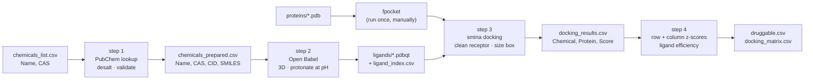

# GRAS-Docking

A four-step, reproducible pipeline for screening food additives (GRAS-listed
chemicals) against a panel of protein structures by molecular docking, and for
ranking the results by **target specificity** rather than by raw docking score.


> **Scope.** This pipeline generates ranked hypotheses. A hit is a compound worth
> testing in an assay — not evidence that it binds. Please read
> [`docs/CAVEATS.md`](docs/CAVEATS.md) before interpreting any output.

---

## Pipeline



**The ranking idea.** A raw docking score is dominated by ligand size, so
comparing chemicals to each other on absolute score mostly ranks them by
molecular weight. Instead, each score is normalised twice: against the
chemical's own mean over all proteins (`Z_Chem` — does this compound like this
target more than its other targets?) and against the protein's mean over all
chemicals (`Z_Prot` — is this protein unusually fond of this compound, or does
it bind everything?). A plausible specific interaction stands out on both.

---

## Installation

The Python side is pip-installable; the three workhorse binaries are not.
Conda is by far the easiest route:

```bash
conda env create -f environment.yml
conda activate gras-docking
```

Or install manually:

```bash
pip install -r requirements.txt
conda install -c conda-forge openbabel fpocket
conda install -c bioconda smina          # or build from https://sourceforge.net/projects/smina/
```

Check that everything is reachable:

```bash
python -c "import pandas, pubchempy, rdkit; print('python deps ok')"
obabel -V && smina --version && fpocket -h | head -1
```

RDKit is optional but strongly recommended — without it, desalting falls back to
a weaker heuristic and ligand efficiency cannot be computed.

---

## Quickstart

```bash
# 0. your input: a two-column CSV
cp data/example_chemicals.csv chemicals_list.csv

# 1. name / CAS  ->  clean SMILES
python scripts/step1_fetch_smiles.py -i chemicals_list.csv

# 2. SMILES  ->  3D ligands, protonated at pH 6.5
python scripts/step2_build_ligands.py --ph 6.5

# 3a. pocket detection - run ONCE per structure, before docking
mkdir -p proteins   # put your .pdb files here
for f in proteins/*.pdb; do fpocket -f "$f"; done

# 3b. dock everything against everything
python scripts/step3_dock.py --exhaustiveness 16 --cpu 8

# 4. rank by specificity
python scripts/step4_analyze.py
```

Steps 1–3 are all restartable: rerun the same command after an interruption and
finished work is skipped (`--overwrite` forces a clean rerun).

---

## The steps in detail

### Step 1 — `step1_fetch_smiles.py`

Resolves each `Name,CAS` pair through PubChem, keeps the largest organic
fragment (desalting), validates it with RDKit, and applies size limits.

| Option | Default | Notes |
|---|---|---|
| `-i, --input` | `chemicals_list.csv` | two columns: `Name`, `CAS` |
| `-o, --output` | `chemicals_prepared.csv` | `Name,CAS,CID,SMILES,MolecularWeight,Source` |
| `--failed` | `chemicals_failed.csv` | everything that did not resolve, **with a reason** |
| `--max-mw` | `900` | Da; docking is unreliable well below this |
| `--min-heavy` | `5` | drop fragments too small to be a ligand |
| `--pause` / `--retries` | `0.25` / `3` | PubChem asks for ≤5 requests/s |

Always look at `chemicals_failed.csv` and at the `CID` column — PubChem's first
hit for a trivial name is not always the compound you meant.

### Step 2 — `step2_build_ligands.py`

Open Babel generates a 3D conformer and protonates at the requested pH.

| Option | Default | Notes |
|---|---|---|
| `--ph` | `6.5` | **set this to your system's pH** |
| `--gen3d` | `med` | `fastest … best`; higher costs time |
| `--minimize FF` | off | e.g. `MMFF94`, with `--steps` |
| `--timeout` | `60` | seconds per molecule; flexible polymers hang |

Writes `ligands/ligand_index.csv`, which maps the sanitized file name back to
name / CAS / CID / SMILES. Keep it — steps 3 and 4 only see the file stem.

### Step 3 — `step3_dock.py`

Requires fpocket output next to each PDB (`<name>_out/pockets/…`). For each
protein it cleans the structure, converts it to a rigid receptor, derives the
box from the pocket, and docks every ligand.

| Option | Default | Notes |
|---|---|---|
| `--pocket-rank` | `1` | fpocket's top pocket ≠ the active site; verify it |
| `--box-padding` / `--box-min` / `--box-max` | `4` / `18` / `30` | box follows the pocket extent |
| `--exhaustiveness` | `8` | use **16–32** for anything you will publish |
| `--seed` | `42` | fixed, so runs are reproducible |
| `--keep-het` | off | retain cofactors (waters are always removed) |
| `--cpu` / `--timeout` | `4` / `900` | per docking run |

Output `docking_results.csv` has a `Status` column: a failed run is recorded
with an empty score and its reason, never as a fake number.

### Step 4 — `step4_analyze.py`

| Option | Default | Notes |
|---|---|---|
| `--min-proteins` | `5` | a z-score over 2–3 proteins is meaningless |
| `--z-threshold` | `-1.5` | per-chemical specificity |
| `--protein-z-threshold` | off | e.g. `-1.5` to also require per-protein novelty |
| `--std-threshold` | `1.5` | rejects flat, promiscuous profiles |
| `--score-lead-min` | `-8.0` | **size-biased**; `--no-lead-filter` to drop it |
| `--ligand-index` | `ligands/ligand_index.csv` | enables ligand efficiency |

Prints a filtering audit (how many rows and chemicals were removed at each
stage) so nothing disappears silently, and writes both the hit list
(`druggable.csv`) and the full wide matrix (`docking_matrix.csv`).

---

## Repository layout

```
GRAS-Docking/
├── scripts/          the maintained pipeline
├── legacy/           the original scripts, unmodified, for provenance
├── data/             example input
├── docs/
│   ├── CHANGES.md    every fix vs. the originals, and which ones move results
│   └── CAVEATS.md    method limits - read before publishing
├── tests/            pytest suite (no network / binaries needed)
├── environment.yml
└── requirements.txt
```

Run the tests with `pytest -q`.

---

## Reproducibility notes

* Record the versions used: `obabel -V`, `smina --version`, `fpocket -h | head -1`,
  `pip freeze | grep -E "rdkit|pubchempy|pandas"`, and the PubChem access date
  (PubChem content changes).
* `--seed` makes a run repeatable but not stable. Re-run the shortlist with
  several seeds and report the spread.
* The prepared receptors in `receptors_prepared/` and `ligands/` are the actual
  inputs to docking — archive them alongside the results, not just the PDB IDs.

## Citation

If this pipeline contributes to a publication, please cite the underlying tools:

* **smina** — Koes DR, Baumgartner MP, Camacho CJ. *J Chem Inf Model* 2013;53(8):1893-1904.
* **AutoDock Vina** (scoring function) — Trott O, Olson AJ. *J Comput Chem* 2010;31(2):455-461.
* **Open Babel** — O'Boyle NM, et al. *J Cheminform* 2011;3:33.
* **fpocket** — Le Guilloux V, Schmidtke P, Tuffery P. *BMC Bioinformatics* 2009;10:168.
* **PubChem** — Kim S, et al. *Nucleic Acids Res* 2023;51(D1):D1373-D1380.
* **RDKit** — https://www.rdkit.org

## License

MIT — see [LICENSE](LICENSE).
